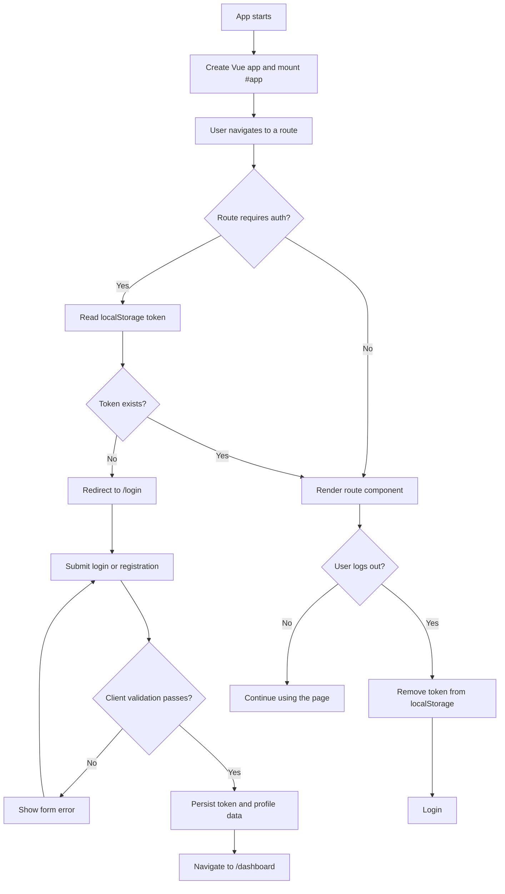
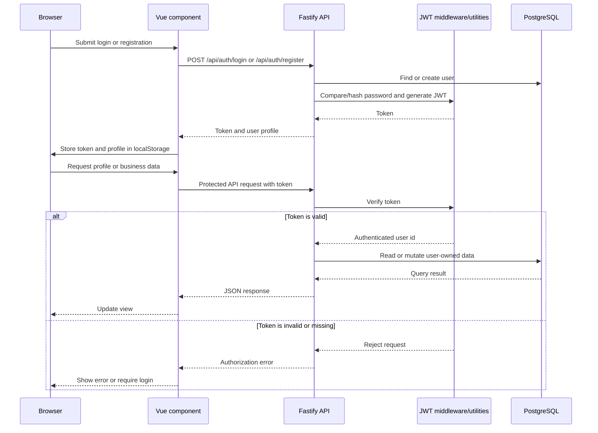
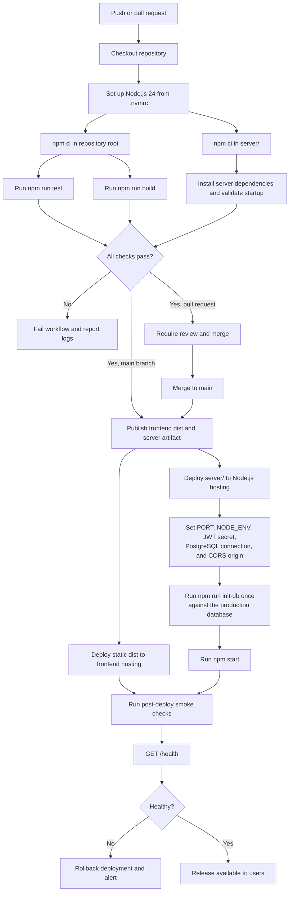
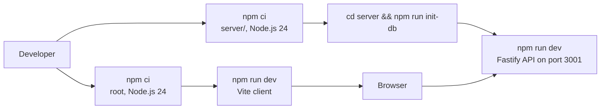

# Amoth Consulting Services Workflow

This document describes the current application flow and CI/CD path. The runtime diagrams reflect the code in this repository. The CI/CD workflow validates changes and deploys the application; production hosting configuration is supplied through GitHub environment secrets.

## 1. Application Architecture

```mermaid
flowchart LR
    Browser[User browser]
    Client[Vue 3 client<br/>Vite build]
    Router[Vue Router<br/>history mode]
    Storage[(Browser localStorage<br/>token, userProfile, theme, invoices)]
    Api[Fastify API<br/>server/src/server.js]
    Auth[Auth routes<br/>register / login]
    Protected[Protected routes<br/>profile, invoices, projects, tasks, meetings]
    Db[(PostgreSQL database)]

    Browser --> Client
| Services | `GET /api/services`, `GET /api/services/:id` | Public service content |
    Client --> Router
    Router -->|Public pages| Public[Home, About, Services,<br/>Service details, Login, Register]
    Router -->|requiresAuth| Guard{token in<br/>localStorage?}
    Guard -->|No| Login[Redirect to /login]
    Guard -->|Yes| Private[Dashboard, Projects, Profile]
    Client <--> Storage
    Client -->|API requests with auth token| Api
    Api --> Auth
    Api --> Protected
    Auth --> Db
    Setup --> ServerInstall[npm ci in server/ and in `server/`]
    Api --> Health["/health"]
```

## 2. Navigation and Authentication Logic

The global guard is registered in `src/main.js`. Routes marked with `meta.requiresAuth` are `/dashboard`, `/projects`, and `/profile`.



## 3. API and Data Flow



### API surface

| Area | Routes | Data |
| --- | --- | --- |
| Health | `GET /health` | Service status |
| Authentication | `POST /api/auth/register`, `POST /api/auth/login` | Users and JWTs |
| Profile | `/api/profile` | User profile |
| Invoices | `/api/invoices` | Invoice CRUD |
| Projects | `/api/projects` | Project CRUD |
| Tasks | `/api/tasks` | Task CRUD |
| Meetings | `/api/meetings` | Meeting CRUD |
| Services | `GET /api/services`, `GET /api/services/:id` | Public service content |

The server initializes the PostgreSQL pool before registering the API server and closes it during graceful shutdown. CORS is enabled for client-to-API requests.

## 4. Recommended CI/CD Deployment Flow

The repository now includes `.github/workflows/deploy.yml`. It validates pull requests and pushes, deploys `main` (or a manual dispatch) over SSH, and expects the production host to provide persistent storage and a process manager. The root package exposes `npm run test:server`, `npm run init-db`, and `npm start` for backend validation and operation.



## 5. CI/CD Gates and Deployment Notes

1. **Runtime and install:** Use Node.js 24.x (specified in `.nvmrc`) and `npm ci` from the repository root and in `server/`.
2. **Client verification:** Run `npm run test -- --run` and `npm run build`. The test command also writes coverage output.
3. **Server verification:** Run `npm run test:server`, initialize an isolated PostgreSQL database, start the API, and check `GET /health`.
4. **Build artifact:** The workflow uploads the generated root `dist/` directory between validation and deployment.
5. **API runtime:** Deploy `server/` as a Node.js 24 service on port `3001`. The deployment workflow checks the host version before installing dependencies.
6. **Database:** Provision PostgreSQL separately and keep its connection details in the remote `.env`. The deployment must not replace the database or its data.
7. **Secrets:** Configure `DEPLOY_HOST`, `DEPLOY_USER`, `DEPLOY_PATH`, `DEPLOY_SSH_KEY`, and `DEPLOY_RESTART_COMMAND` in the `production` environment. `DEPLOY_SSH_PORT` is optional and defaults to `22`.
8. **Remote environment:** Keep `server/.env` on the host with production `NODE_ENV`, `JWT_SECRET`, `DATABASE_HOST`, `DATABASE_PORT`, `DATABASE_NAME`, `DATABASE_USERNAME`, `DATABASE_PASSWORD`, `DATABASE_SSL`, `PORT`, and any CORS settings required by the deployment.
9. **Release check:** The workflow runs `GET /health` after restarting the API. Add a frontend URL check and rollback command to the hosting setup when those capabilities are available.

## 6. AWS Account Security

Before using AWS for production, complete the root and IAM MFA checklist in [AWS_SECURITY.md](AWS_SECURITY.md). AWS account MFA is separate from application authentication: it protects AWS administrators and deployment identities, while `/api/auth/login` protects application users.

## 7. Local Development



Run the client and API in separate terminals. The API defaults to port `3001`; the Vite client uses its normal development port.